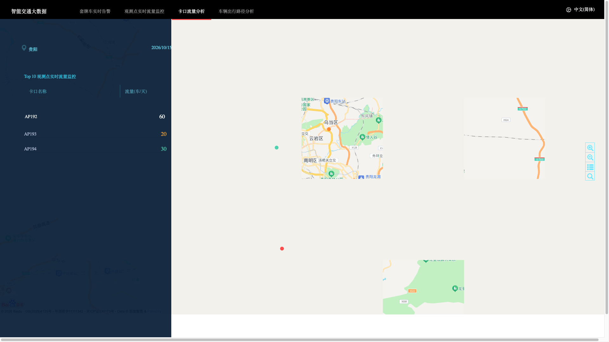

# 智能交通大数据分析系统（贵阳本地学习版）

> 基于 Apache Storm + Kafka + 百度地图的实时交通大数据分析演示系统，已改造为本地一键运行，演示数据从上海迁移到贵阳。

    

原工程为华为云 MRS 官方示例 `storm-car-analysis-example`，本仓库在其基础上做了完整改造，使其能在个人电脑上直接跑起来，适合学习大数据实时处理全链路。

---

## 效果展示

### 实时流量监控（TOP10 卡口）


### 套牌车实时告警


### 车辆出行路径分析


### 卡口流量统计


---

## 一、系统在做什么

模拟城市道路上的车辆经过卡口（摄像头）的数据采集，然后实时分析：

1. **数据产生**：模拟每个卡口的摄像头持续拍过车，每辆车经过时上报：车牌号、经过时间、经纬度、车速、方向
2. **数据传输**：这些上报数据通过 Kafka 消息队列缓冲，供下游消费
3. **实时分析**：Storm 流式计算做三件事：
   - 统计每个卡口每分钟过车量 → 实时流量排行
   - 检测同一车牌短时间出现在两个远距离卡口 → 套牌车告警
   - 统计高频 OD（起点→终点）出行路径 → 路径分析大屏
4. **数据展示**：Web 前端用百度地图把卡口点位、告警车辆、路径连线画出来，左侧列表显示 TOP 排行

---

## 二、数据从哪来

### 2.1 原始数据文件（离线数据）

`detail-records/` 目录下是 9 天的车辆过车明细（CSV 格式），每行一条记录：

```
卡口ID,车牌号,纬度,经度,车速,方向,?,时间,?,?,...
xiezhi1000006,贵A6CU11,30.581955,114.315308,65,315,,2024-01-01 08:00:07,1
```

这些数据是离线分析页面的数据源——路径分析（`#/carMovement/map`）和套牌车分析（`#/fakeCar/map`）读取这些文件，做历史数据回放展示。

### 2.2 实时数据（本地假数据模式）

原版工程通过 Kafka + Storm 集群实时消费，但本地没有集群。我们在后端配置了 `use.dummy.data=true`，后端直接按贵阳 62 个真实路口坐标生成模拟过车数据，无需搭建集群即可看到实时大屏效果。

> 真实部署时：卡口摄像头 → Kafka（Topic: car_topic）→ Storm Topology（Spout 消费 → Bolt 聚合/检测）→ 写入 Redis/HBase → Web 后端查询返回。

---

## 三、系统架构

```
┌─────────────────────────────────────────────────────────┐
│                    数据采集层                             │
│  卡口摄像头 / 模拟生产者                                   │
│  每条记录: 车牌 + 经纬度 + 时间 + 车速                     │
└──────────────────────┬──────────────────────────────────┘
                       │
                       ▼
┌─────────────────────────────────────────────────────────┐
│                    消息队列层                             │
│  Kafka (Topic: car_topic)                               │
│  高吞吐缓冲，解耦生产与消费                                │
└──────────────────────┬──────────────────────────────────┘
                       │
                       ▼
┌─────────────────────────────────────────────────────────┐
│                    实时计算层                             │
│  Apache Storm Topology                                  │
│  ┌─────────────┐  ┌──────────────┐  ┌────────────────┐ │
│  │ SearchXCar  │  │ CarSumPerMin │  │ CarSumTopology  │ │
│  │ 套牌车检测   │  │ 分钟级流量统计 │  │ 路径聚合        │ │
│  └─────────────┘  └──────────────┘  └────────────────┘ │
└──────────────────────┬──────────────────────────────────┘
                       │
                       ▼
┌─────────────────────────────────────────────────────────┐
│                    存储/服务层                            │
│  Redis (实时结果缓存) / HBase (明细)                      │
│  本项目本地模式: 直接返回模拟数据                          │
└──────────────────────┬──────────────────────────────────┘
                       │
                       ▼
┌─────────────────────────────────────────────────────────┐
│                    展示层                                │
│  Tomcat 9 + AngularJS 1.x + 百度地图 JS API              │
│  - 实时流量大屏 (TOP10 卡口)                              │
│  - 套牌车告警列表 + 地图标注                              │
│  - 高频路径连线图                                         │
│  - 卡口流量趋势图                                        │
└─────────────────────────────────────────────────────────┘
```

---

## 四、四大功能模块

| 模块 | 路由 | 说明 |
|------|------|------|
| 🚨 套牌车实时告警 | `#/fakeCar/map` | 同一车牌短时间内出现在距离过远的两个卡口，判定为套牌车。左侧列表展示嫌疑车牌和两个出现位置 |
| 📊 观测点实时流量监控 | `#/highTraffic/map` | TOP10 卡口实时车流量排行，红/橙/绿三色热度条，地图上绿色点 = 卡口位置 |
| 🛣️ 卡口流量分析 | `#/trafficStat/map` | 按时间统计各卡口流量趋势 |
| 🗺️ 车辆出行路径分析 | `#/carMovement/map` | 高频 OD（起点-终点）路径连线，线条粗细代表车次多少 |

---

## 五、本地快速启动（5 分钟）

### 环境要求
- macOS / Linux
- JDK 8（Corretto / OpenJDK 均可，**不要用 JDK 11+**，Storm 1.x 不兼容）
- Tomcat 9（**不要用 Tomcat 10+**，本项目用 `javax.servlet` 老 API）

### 步骤

```bash
# 1. 克隆
git clone https://gitee.com/xuchenjoin/car-analysis-guiyang.git
cd car-analysis-guiyang/hccDemo

# 2. 软链到 Tomcat webapps（按你本机路径改）
ln -s $(pwd) /opt/homebrew/opt/tomcat@9/libexec/webapps/hccDemo

# 3. 确认假数据模式已开启
cat WEB-INF/classes/app.conf | grep use.dummy.data
# 应显示 use.dummy.data=true

# 4. 启动 Tomcat
export JAVA_HOME=/path/to/jdk8
/opt/homebrew/opt/tomcat@9/libexec/bin/catalina.sh run
```

浏览器打开：

| 页面 | URL |
|------|-----|
| 首页 | http://localhost:8080/hccDemo/ |
| 套牌车告警 | http://localhost:8080/hccDemo/#/fakeCar/map |
| 实时流量监控 | http://localhost:8080/hccDemo/#/highTraffic/map |
| 卡口流量分析 | http://localhost:8080/hccDemo/#/trafficStat/map |
| 车辆路径分析 | http://localhost:8080/hccDemo/#/carMovement/map |

---

## 六、目录结构

```
car-analysis-guiyang/
├── pom.xml                          # Maven 构建（Storm Topology）
├── src/main/java/com/lpssy/storm/  # Storm 实时计算代码
│   ├── SearchXCarTopology.java     # 套牌车检测拓扑
│   ├── SearchXCarBolt.java         # 套牌车判定 Bolt
│   ├── SearchXCarAggrBolt.java     # 聚合 Bolt
│   ├── SearchCarSumTopology.java    # 流量统计拓扑
│   ├── SearchCarSumPerMinuteBolt.java # 分钟级统计
│   ├── KafkaUtils.java             # Kafka 工具类
│   └── TopicsTupleBuilder.java     # 数据序列化
├── hccDemo/                         # Web UI（可部署到 Tomcat）
│   ├── index.html                  # 入口页
│   ├── main.js                     # RequireJS 配置
│   ├── lib/baidu/map.js            # 百度地图封装（含贵阳 62 个路口坐标）
│   ├── src/app/
│   │   ├── framework/views/menus.html       # 顶部导航
│   │   └── dataAccess/controllers/          # 各页面控制器
│   │       ├── fakeCarCtrl.js             # 套牌车告警逻辑
│   │       ├── highTrafficCtr.js          # 实时流量排行
│   │       ├── carMovementCtrl.js         # 路径分析
│   │       └── trafficStaticsCtrl.js      # 卡口统计
│   └── WEB-INF/classes/app.conf           # 配置（use.dummy.data=true）
├── detail-records/                  # 离线过车明细数据（9 天 CSV）
│   ├── detail_record_2024_01_03_08_00_00
│   ├── detail_record_2024_01_04_08_00_00
│   └── ...（共 9 个文件，约 28MB）
└── docs/screenshots/               # 本文档使用的截图
```

---

## 七、关键改造点（相对于原版华为云示例）

原版依赖内网 Kafka/Storm 集群（192.168.133.131），本地完全跑不起来。本仓库改造：

1. **启用假数据模式**：`WEB-INF/classes/app.conf` 设 `use.dummy.data=true`，跳过 Kafka 直接返回测试数据
2. **地图容器修复**：原版 Angular UI Router + tiny-layout 把地图容器裁剪成约 260×260，改为 body 下全屏 `#fullscreen-map` div
3. **数据迁移到贵阳**：
   - 62 个贵阳真实路口坐标（云岩/南明/观山湖/花溪/白云/乌当）
   - 路径起点终点映射到贵阳真实地标（喷水池、大十字、甲秀楼、花果园、贵阳北站、观山湖公园、花溪公园、青岩古镇等）
   - 左上角城市标签从"上海"改为"贵阳"
4. **去除华为云标识**：删除"华为云首页"链接、"购买 MRS"红色按钮、华为版权信息
5. **修复选中 tab 双层边框**（蓝色 outline + 红色下边框）

---

## 八、学习要点

| 技术点 | 在本项目中的体现 |
|--------|-----------------|
| **Storm 实时计算** | Spout 消费 Kafka → Bolt 链式处理 → 时间窗口聚合 |
| **Kafka 消息队列** | 高吞吐车辆轨迹数据接入，解耦采集与计算 |
| **AngularJS 1.x** | UI Router 路由、ng-include、双向绑定、RequireJS 模块化 |
| **百度地图 JS API** | Marker 标注、CurveLine 路径连线、InfoWindow 信息窗、热力图 |
| **Tomcat WAR 部署** | 老版 `javax.servlet` 与 Tomcat 9 的兼容性 |
| **套牌车算法** | 同一车牌在 N 分钟内出现在距离 > M 公里的两个卡口 → 疑似套牌 |

---

## 九、免责声明

- 本项目仅供学习参考，地图数据 © 百度智图
- 原工程版权归华为技术有限公司，基于 Apache 2.0 协议
- 改造部分（贵阳数据、本地启动、文档）以 MIT 协议发布

## License

Apache-2.0
