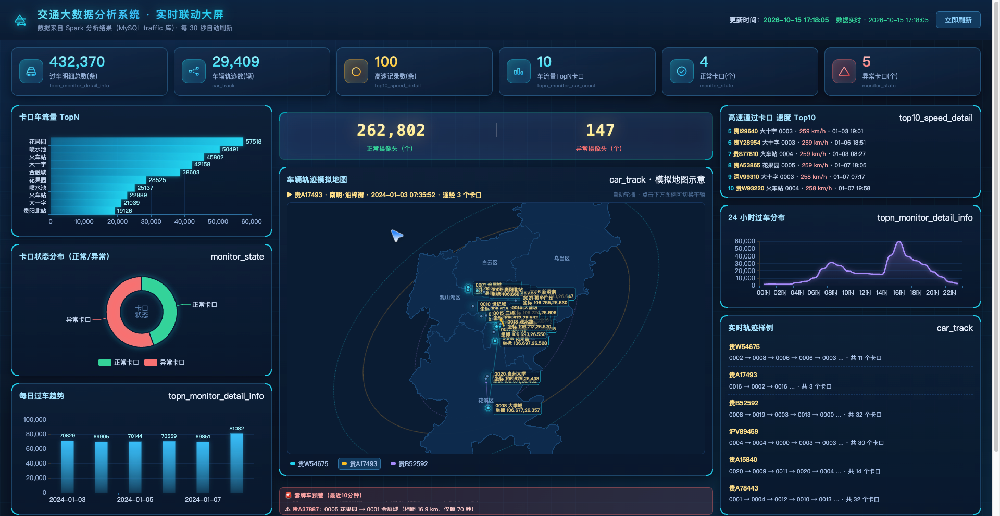
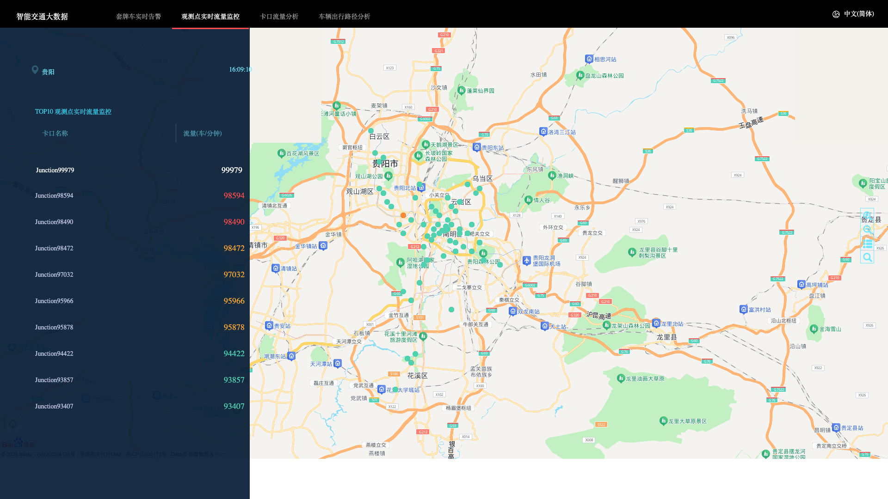
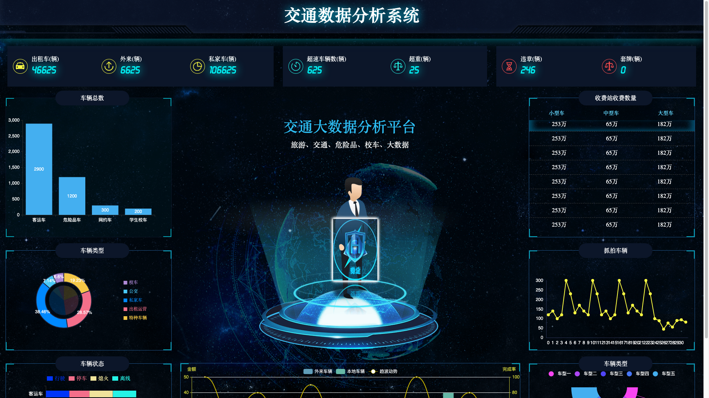
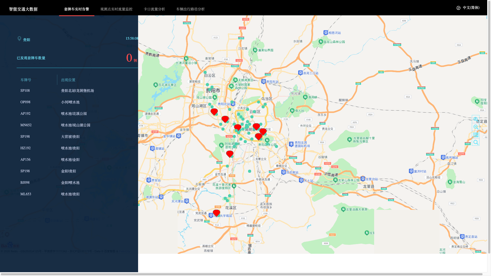
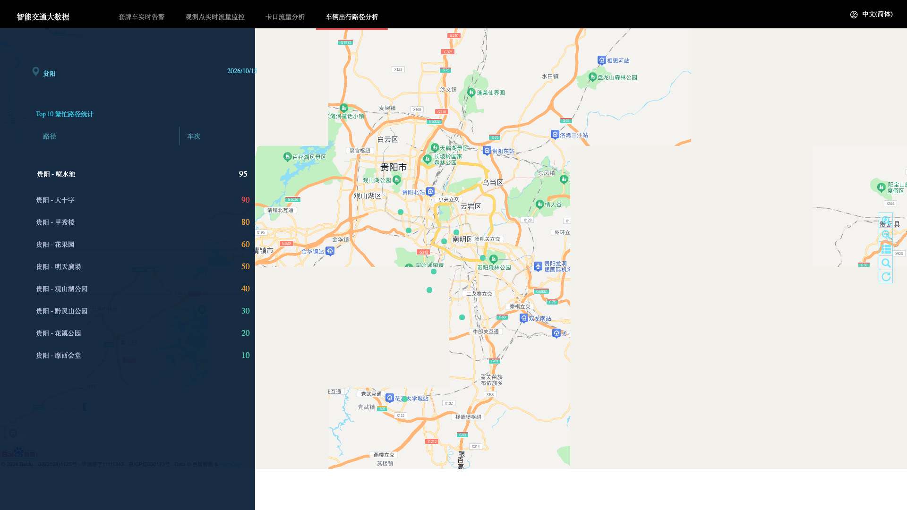

# 交通大数据系统设计与实现

> 贵州省六盘水师范学院 20 届毕业生毕业设计成果
>
> 从数据模拟、离线分析、实时计算到可视化大屏的完整交通大数据教学项目。基于 Apache Storm + Kafka + Spark + 百度地图，本地即可一键运行。

    

本项目参考了华为云 MRS（MapReduce Service）的实时交通分析技术方案，整合了 Storm 实时计算、Spark 离线分析和前端可视化，所有数据均为本地模拟生成，无需真实集群即可运行，适合学习大数据全链路开发。

---

## 效果展示

### 实时联动大屏（总览）


### 实时流量监控（百度地图）


### 交通数据分析 BI 大屏


### 套牌车实时告警


### 车辆出行路径分析


---

## 项目整体架构

```
┌──────────────────────────────────────────────────────────────┐
│                        数据模拟层                             │
│  模拟卡口摄像头过车记录 (车牌/时间/经纬度/车速)                 │
│  monitor_camera_info (卡口信息表)                             │
│  monitor_flow_action (过车明细表)                             │
└──────────────────────────┬───────────────────────────────────┘
                           │
              ┌────────────┴────────────┐
              ▼                        ▼
┌──────────────────────────┐  ┌──────────────────────────────┐
│     离线分析层 (Spark)     │  │     实时计算层 (Storm)        │
│  traffic-spark/           │  │  carAnalysis/src/            │
│  - 车辆轨迹分析            │  │  - 套牌车实时检测             │
│  - 区域道路流量统计         │  │  - 实时流量统计               │
│  - 随机抽车/同行车分析      │  │  - Kafka → Storm → Redis     │
│  - Hive 数仓导入           │  │                              │
│  offline-spark/ (Spark学习)│  │                              │
│  offline-pyspark/ (PySpark)│  │                              │
└──────────────┬───────────┘  └──────────────┬───────────────┘
               │                             │
               └──────────────┬──────────────┘
                              ▼
┌──────────────────────────────────────────────────────────────┐
│                      可视化展示层                              │
│                                                              │
│  carAnalysis/hccDemo/  → 百度地图 Web 大屏 (Tomcat+AngularJS) │
│  bi-dashboard/         → 交通数据 BI 可视化大屏 (纯 HTML)      │
│  vehicle-platform/     → 车辆综合管控平台 (纯 HTML)            │
└──────────────────────────────────────────────────────────────┘
```

**数据流向：** 模拟过车数据 → Kafka 消息队列 → Storm 实时计算（套牌检测/流量统计）→ Web 后端查询 → 百度地图渲染。离线数据则通过 Spark 批量分析后在 BI 大屏展示。

---

## 目录结构（每个模块干什么）

```
car-analysis-guiyang/
│
├── 📡 carAnalysis/ — 实时分析 Web 大屏（参考华为云 MRS Storm 方案）
│   ├── hccDemo/                 # Tomcat 部署的 Web 应用
│   │   ├── index.html           # 入口页
│   │   ├── lib/baidu/map.js    # 百度地图封装（本地路口坐标）
│   │   └── src/app/dataAccess/controllers/
│   │       ├── fakeCarCtrl.js        # 套牌车告警页面：列表+地图标注
│   │       ├── highTrafficCtr.js     # 实时流量 TOP10 排行
│   │       ├── carMovementCtrl.js   # 车辆出行路径连线
│   │       └── trafficStaticsCtrl.js # 卡口流量统计
│   ├── src/main/java/          # Storm Topology 实时计算代码
│   │   ├── SearchXCarTopology.java   # 套牌车检测拓扑（Spout→Bolt链）
│   │   ├── SearchXCarBolt.java       # 套牌车判定逻辑
│   │   ├── SearchCarSumTopology.java # 分钟级流量统计拓扑
│   │   └── KafkaUtils.java           # Kafka 生产者/消费者
│   └── detail-records/         # 模拟过车轨迹数据 (9天CSV, ~28MB)
│
├── ⚙️ traffic-spark/ — Spark 离线分析主项目
│   ├── src/main/java/com/lpssy/spark/
│   │   ├── dao/               # 数据访问层（卡口/车辆/轨迹/任务 DAO）
│   │   │   ├── impl/          # DAO 实现（读写 HBase/MySQL）
│   │   │   └── factory/       # DAO 工厂模式
│   │   ├── areaRoadFlow/      # 区域道路流量 Top3 分析 + UDF/UDAF
│   │   ├── skynet/            # 天网分析（流量/随机抽车/同行车）
│   │   ├── rtmroad/           # 道路实时分析
│   │   ├── domain/            # 实体类（CarTrack/Monitor/Task）
│   │   ├── jdbc/              # JDBC 连接 MySQL
│   │   ├── conf/              # 配置管理
│   │   └── util/              # Spark/日期/参数工具类
│   ├── monitor_camera_info    # 模拟卡口信息数据
│   ├── monitor_flow_action    # 模拟过车明细数据
│   └── pom.xml                # Maven 构建
│
├── 📚 offline-spark/ — Spark 学习示例（Java + Scala 双语言）
│   └── src/main/
│       ├── java/com/lpssy/javaspark/
│       │   ├── core/examples/    # WordCount, TopN, 二次排序等
│       │   ├── actions/          # RDD action 算子（reduce/collect/take）
│       │   └── streaming/        # Spark Streaming + Kafka → Redis
│       └── Scala/com/lpssy/scalaspark/
│           ├── core/transformations/  # map/flatMap/join/groupBy 等算子
│           ├── core/actions/          # Scala 版 action
│           ├── sql/                   # Spark SQL + DataFrame + Hive
│           ├── streaming/            # Spark Streaming + Kafka offset
│           └── persist/              # 缓存/检查点
│
├── 🐍 offline-pyspark/ — PySpark 脚本
│   ├── mockData.py            # 模拟交通数据生成器
│   ├── basePython.py          # Python 基础练习
│   ├── pvuvTest.py            # PV/UV 统计
│   ├── trafficdata/           # 交通测试数据
│   └── car_types/             # 车型分类数据
│
├── 📊 bi-dashboard/ — 交通数据 BI 可视化大屏（纯 HTML，双击即开）
│   ├── index.html             # BI 大屏：车辆统计/类型饼图/收费站/抓拍趋势
│   ├── realtime.html          # 实时数据大屏
│   ├── login.html             # 登录页
│   ├── css/ js/ images/      # ECharts 图表 + 暗黑科技风
│   └── picture/               # 背景图素材
│
└── 🚗 vehicle-platform/ — 车辆综合管控平台（纯 HTML）
    ├── index.html             # 管控平台主界面
    ├── css/ js/ images/      # 车辆列表 + 地图 + 管控操作
    └── picture/               # 素材图片
```

---

## 四大可视化页面

### 1. 实时流量监控
- 路径：`hccDemo/` 部署到 Tomcat 后访问
- 功能：TOP10 卡口实时车流量排行，红/橙/绿三色热度条，地图绿色点 = 卡口位置
- 技术：AngularJS 1.x + 百度地图 JS API

### 2. 套牌车实时告警
- 路径：`hccDemo/#/fakeCar/map`
- 功能：同一车牌短时间内出现在距离过远的两个卡口，判定为套牌车并告警
- 左侧列表显示嫌疑车牌和两个出现位置

### 3. 车辆出行路径分析
- 路径：`hccDemo/#/carMovement/map`
- 功能：高频 OD（起点→终点）路径连线，线条粗细代表车次多少

### 4. BI 数据大屏
- 路径：直接浏览器打开 `bi-dashboard/index.html`
- 功能：车辆总数柱状图、车型饼图、收费站收费统计、抓拍车辆趋势线
- 技术：ECharts + 暗黑科技风，无需后端

---

## 数据说明（全部本地模拟）

### 过车明细数据 (monitor_flow_action)
模拟卡口摄像头拍的每一条过车记录：
```
日期        卡口ID  车道  车牌       时间              速度  方向
2024-05-28  0003   36200  粤B38678  2024-05-28 12:46:50  98   43
```

### 卡口信息数据 (monitor_camera_info)
模拟卡口编号和位置信息：
```
卡口ID   卡口编号
0006    66210
```

### 离线轨迹数据 (detail-records/)
9 天的完整过车轨迹 CSV，每行一条记录，供路径分析页面回放：
```
卡口ID,车牌,纬度,经度,车速,方向,时间
```

---

## 本地运行

### 1. 实时 Web 大屏（hccDemo）
```bash
# 需要 JDK 8 + Tomcat 9（不要用 Tomcat 10+）
ln -s $(pwd)/hccDemo /opt/homebrew/opt/tomcat@9/libexec/webapps/hccDemo
/opt/homebrew/opt/tomcat@9/libexec/bin/catalina.sh run
# 打开 http://localhost:8080/hccDemo/
```

### 2. BI 大屏 / 车辆管控平台
直接用浏览器打开 HTML 文件即可，无需任何后端：
```bash
open bi-dashboard/index.html
open vehicle-platform/index.html
```

### 3. Spark 离线分析
```bash
cd traffic-spark
mvn package
# 将 monitor_flow_action 和 monitor_camera_info 放到 HDFS
# 运行各 DAO 层 Spark 任务
```

---

## 学习要点

| 技术 | 在项目中的位置 |
|------|---------------|
| **Storm 实时计算** | `carAnalysis/src/` — Spout/Bolt 拓扑、流式处理、套牌检测 |
| **Kafka 消息队列** | `carAnalysis/src/` — 高吞吐过车数据接入与解耦 |
| **Spark 离线分析** | `traffic-spark/` — DAO 层 + Spark SQL + UDF/UDAF + 轨迹分析 |
| **Spark 算子大全** | `offline-spark/` — Java/Scala 版 RDD/算子/Streaming/SQL 示例 |
| **PySpark** | `offline-pyspark/` — Python 版数据处理与模拟 |
| **ECharts 可视化** | `bi-dashboard/` — 暗黑科技风数据大屏 |
| **百度地图 JS API** | `hccDemo/lib/baidu/` — Marker/CurveLine/信息窗 |
| **AngularJS 1.x** | `hccDemo/` — UI Router + RequireJS + 双向绑定 |

---

## 联系作者

有问题或交流学习，扫码加微信：


---

## 致谢

- 实时计算架构参考了华为云 MRS（MapReduce Service）的 Storm 实时交通分析方案
- 地图数据 © 百度智图
- 本项目仅供学习交流使用
